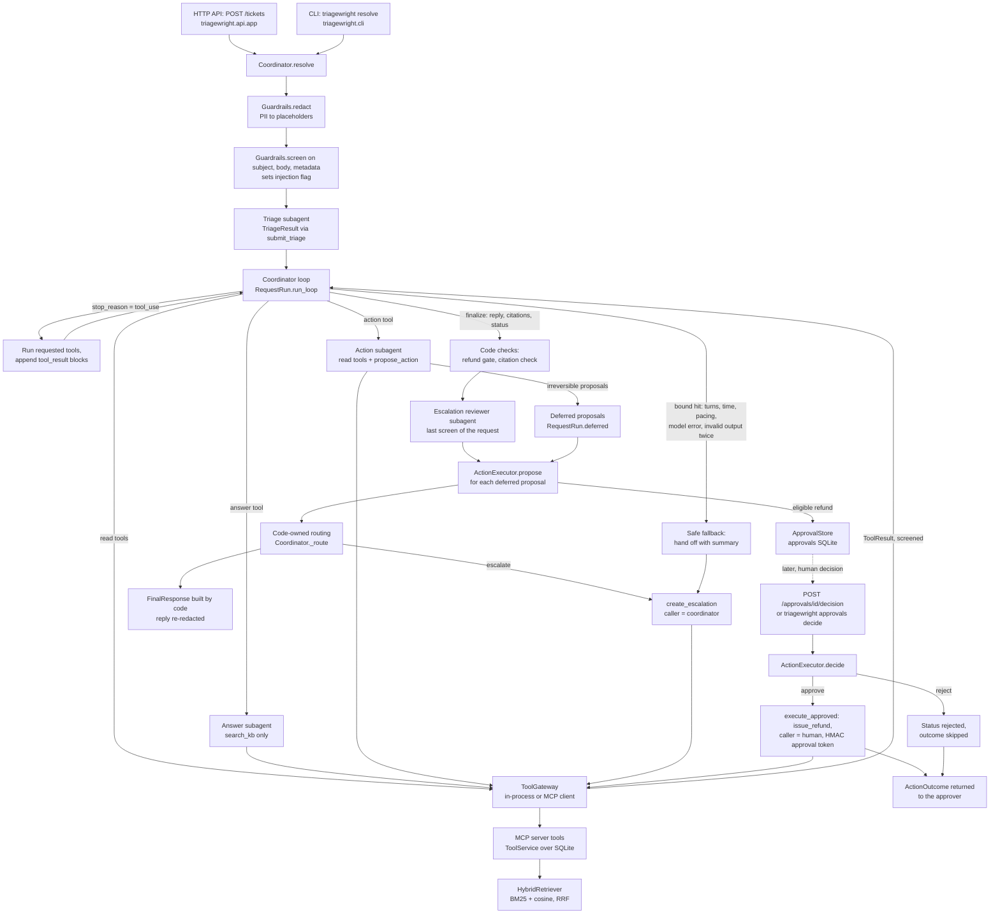
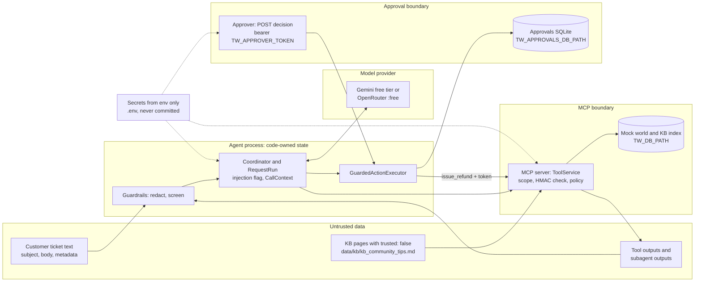

# Architecture

This document describes triagewright as it is on `main`: how one ticket flows
through the system, where the trust boundaries are, what each component
promises, and which decisions belong to code rather than to a model. The
decisions behind it are in [ADR-001](adr/ADR-001-stack-and-architecture.md) and
the later ADRs in [`docs/adr/`](adr/). The expected agent behavior is the
contract in [`docs/contracts/behavior.md`](contracts/behavior.md).

All paths below are relative to the repository root. Python modules are under
`src/triagewright/` and are written as `triagewright.<module>`.

## 1. Request flow

One ticket becomes one `FinalResponse`. The API (`POST /tickets`) and the CLI
(`triagewright resolve`) both call `TicketResolver.resolve`, which is
implemented by `Coordinator` in `triagewright.agent.coordinator`. The eval
runner calls the same resolver on a per-case stack.

Step by step (code in the `triagewright.agent` package unless noted:
`Coordinator` in `triagewright.agent.coordinator`, with its final checks, replies,
and routing in `triagewright.agent.refunds`, `triagewright.agent.replies`, and
`triagewright.agent.routing`; `RequestRun` in `triagewright.agent.runtime`, built
from `triagewright.agent.state`, `triagewright.agent.tool_calls`,
`triagewright.agent.loop`, and `triagewright.agent.common`):

1. **Ingress.** `POST /tickets` validates the body as `contracts.tickets.Ticket`
   and calls the resolver. The CLI builds the ticket from a JSON or YAML file,
   or from flags, and does the same. A
   request id is derived with `common.stable_id("req", ticket_id)`.
2. **Redaction.** `Coordinator._redact_ticket` replaces PII in the subject,
   body, and metadata keys and values with numbered placeholders before any
   model sees the ticket.
3. **Screen.** `RequestRun.screen` runs `Guardrails.screen` on the ticket text
   (`ContentSource.CUSTOMER`) and ORs the verdict into the request-scoped
   `injection` flag.
4. **Triage subagent.** `subagents.triage` gets only `TriageInput` and returns
   a validated `TriageResult` through a forced `submit_triage` tool call.
   Triage's own `injection_suspected` is ORed into the flag too.
5. **Coordinator loop.** `RequestRun.run_loop` is the bounded agentic loop.
   Each turn sends the transcript and branches on `stop_reason`:
   `tool_use` runs every requested tool and appends `tool_result` blocks;
   `end_turn` and `stop_sequence` force the output tool; `max_tokens` gets one
   continuation; `pause_turn` continues; `refusal` raises `Refused`. The
   loop's tools are `answer`, `action`, the read-only business tools (only
   `search_kb` on a refund ask), and the output tool `finalize`.
   Bounds: `LoopConfig.max_turns`, `turn_timeout_s` per model call,
   `total_timeout_s` per request less `handoff_reserve_s`, and
   `max_pacing_s` of rate-limit waiting. Any bound, a second truncation, or a
   second invalid output raises `Fallback`.
6. **MCP gateway and tools.** Every tool call goes through
   `RequestRun.call_tool`, which sets a code-built `CallContext` (ticket id,
   customer id, caller), retries retryable errors, and records the call. The
   gateway is `InProcessToolGateway` or `McpToolGateway`
   (`triagewright.mcp_server.gateway`); both reach `ToolService`
   (`triagewright.mcp_server.service`). Every result is screened
   (`RequestRun.observe`) before a model sees it.
7. **RAG search with citations.** `search_kb` runs `HybridRetriever.retrieve`
   (`triagewright.rag.retriever`) over the KB index in SQLite. Hits carry
   `chunk_id`, `trusted`, and text. Citations are accepted only by
   `RequestRun.cite`: a trusted hit seen in this request whose text contains
   the quote verbatim.
8. **Answer subagent.** `subagents.answer` gets `AnswerInput` (ticket, triage,
   verified facts) and may call only `search_kb`. Its `AnswerDraft` citations
   are re-checked by code.
9. **Action subagent.** `subagents.action` gets `ActionInput` and calls the
   read tools in `ACTION_TOOLS`. These leave out `check_refund_eligibility`:
   the executor looks it up for every refund proposal. Writes go only through
   its `propose_action` tool, which validates and *defers* irreversible proposals
   (`RequestRun.defer`). Nothing irreversible runs in the loop.
10. **Finalize and code checks.** The model's `finalize` call supplies only
    `FinalizeArgs`: a reply, citation candidates, and a proposed status
    (`resolved`, `needs_info`, or `refused`). `Coordinator._check_final`
    rejects a refund reply that has no verified `kb_refund_policy` citation,
    or that has no `issue_refund` proposal, unless the ticket has no customer,
    injection is already suspected, or the draft is `needs_info` and the order
    is unclear (`_refund_decidable`). The model gets one repair attempt.
11. **Escalation reviewer.** `subagents.review` reviews the accepted
    `finalize` draft, before any deferred proposal is sent, and returns an
    `EscalationDecision`. Its screen is the request's last, so the injection
    flag is final after it.
12. **Action executor.** `Coordinator._propose_deferred` sends each deferred
    proposal to `ActionExecutor.propose` (`GuardedActionExecutor` in
    `triagewright.guardrails.executor`), passing the final injection flag.
13. **Approval queue.** An eligible refund becomes an `ApprovalRequest` in the
    `ApprovalStore` (`SqliteApprovalStore`, `triagewright.guardrails.approvals`),
    and the outcome is `pending_approval`.
14. **Code-owned routing.** `Coordinator._route` decides whether and where to
    escalate (section 4). If it escalates, `Coordinator._handoff` calls
    `create_escalation` as `caller="coordinator"`.
15. **Final response.** `Coordinator._final` builds `FinalResponse` from
    records: `actions` from executor outcomes, `escalation` from the routing
    decision, status by precedence (escalated, pending approval, refused,
    needs info, then the model's proposal). The reply is redacted again.
    `RequestTelemetry.finish` attaches `RequestMetrics`.
16. **Later: the human step.** A reviewer lists approvals (`GET /approvals` or
    `triagewright approvals list`) and decides
    (`POST /approvals/{approval_id}/decision` or `triagewright approvals decide`).
    On approve, `ActionExecutor.decide` runs `execute_approved`, which calls
    `issue_refund` with the stored arguments, `caller="human"`, and an HMAC
    approval token, and returns the outcome to the approver. On reject, the
    approval is recorded as `rejected` and the outcome is `skipped`.

## 2. Trust boundaries

| Boundary | What crosses it | How it is enforced | Code |
| --- | --- | --- | --- |
| Customer text is untrusted data | Ticket subject, body, metadata | Redacted before any model sees it; screened for injection; shown to models only inside `<data>` tags with a "data, not instructions" rule; `customer_id` comes from the ticket, never from model arguments | `Coordinator._redact_ticket`, `RequestRun.screen`, `RequestRun.data_prompt`, `prompts._DATA_RULE` |
| KB pages are untrusted | `search_kb` hits | Every hit is screened as `ContentSource.KB_DOCUMENT`; pages with `trusted: false` are retrieved only when `categories` names their category, and are never cited | `RequestRun.observe`, `HybridRetriever`, `RequestRun.cite` |
| Tool and subagent outputs are untrusted | `ToolResult` JSON, subagent outputs | Screened (`TOOL_OUTPUT`, `MODEL_OUTPUT`); flagged content is wrapped with `as_data`; refund eligibility is parsed into `RefundEligibility`, which holds only ids, numbers, dates, and reason codes | `RequestRun.observe`, `subagents._subagent`, `GuardedActionExecutor.propose` |
| MCP boundary | `tools/call` with `CallContext` in `_meta` under `triagewright/ctx` | MCP clients are trusted: agent code builds the `CallContext`, and the server validates its shape but does not authenticate its fields. Against those fields it checks scope (`UNSCOPED_TOOLS`), reports other customers' records as `not_found`, and accepts `create_escalation` only from `caller="coordinator"` for `ctx.ticket_id`. `issue_refund` separately needs a valid HMAC token (keyed by `TW_APPROVAL_KEY`) and `caller="human"`, and the server re-applies `evaluate_refund` in the insert's transaction. A recognized tool's failure is a `ToolResult` error envelope, not an exception; an unknown tool name is an MCP `INVALID_PARAMS` error. In Compose the MCP port is not published. | `triagewright.mcp_server.server`, `triagewright.mcp_server.service`, `compose.yaml` |
| Authenticated HTTP API is the approval boundary | Approval decisions | `POST /approvals/{approval_id}/decision` requires `Authorization: Bearer` matching `TW_APPROVER_TOKEN` (constant-time compare); unset token disables decisions (503). This is the reviewer boundary. The CLI's `approvals decide` is a local operator path: by default it compares the expected token from settings (environment or `.env`) with `TW_APPROVER_TOKEN` in the process environment, so it checks only that the operator's shell has the token; a token set only in `.env` is not presented. The ticket endpoint is an unauthenticated, trusted internal ingress: a direct run binds `127.0.0.1` by default (`TW_API_HOST`), and Compose publishes it only on the host's `127.0.0.1`. `GET /approvals` (read-only) needs no token. | `require_approver` in `triagewright.api.app`, `triagewright.api.services.token_matches`, `triagewright.cli` |
| Separate approvals SQLite | `ApprovalRequest` rows | Approvals live in `TW_APPROVALS_DB_PATH` (`var/approvals.sqlite`), apart from the mock world and KB index in `TW_DB_PATH`. Status moves only `pending` to `approved` or `rejected`, then `approved` to `executed`, in guarded single-row updates. | `triagewright.guardrails.approvals`, `Settings.approvals_db_path` |
| Secrets from env only | API keys, `TW_APPROVAL_KEY`, `TW_APPROVER_TOKEN` | `Settings` reads `TW_*` and provider key variables from the environment or an uncommitted `.env`; secrets are `SecretStr`; only `.env.example` is committed; CI runs gitleaks. Model error messages carry status codes, never provider free text. | `triagewright.config`, `.env.example`, `.github/workflows/ci.yml`, `triagewright.llm.chat_transport` |

## 3. Component contracts

Every lane talks to the others only through the Protocols in
`src/triagewright/contracts/ports.py`. Models are in
`src/triagewright/contracts/` and exported as JSON Schemas under `schemas/`.
Fakes for every port live in `triagewright.testing.fakes`.

### ModelClient (lane B, model adapters)

| | |
| --- | --- |
| Port | `ports.ModelClient.complete` |
| Input | `contracts.llm.ModelRequest` (Messages-shaped: system, messages, tools, `tool_choice`, `max_tokens`, `purpose`) |
| Output | `contracts.llm.ModelResponse` (content blocks, `stop_reason`, `Usage`, `latency_ms`, `ttft_ms`) |
| Errors | `triagewright.llm.errors`: `ModelConfigError` (non-free model, missing key), `ModelAuthError` (401/403), `ModelRequestError` (other 4xx), `ModelUnavailableError` (429, 5xx, timeout, network after retries), `ModelResponseError` (untranslatable), `ReplayMissError` (no recording) |
| Owner | `triagewright.llm.openai_compat` (`GeminiClient`, `OpenRouterClient`), `triagewright.llm.replay` (`ReplayClient`, `RecordingClient`), built by `triagewright.llm.factory.build_model_clients`; `triagewright.wiring.models.RoleRouter` routes by `purpose` |

### ToolGateway (lane A, MCP)

| | |
| --- | --- |
| Port | `ports.ToolGateway.list_tools`, `ports.ToolGateway.call` |
| Input | `contracts.tools.ToolName`, JSON arguments matching the tool's input model, `contracts.tools.CallContext` |
| Output | `contracts.tools.ToolResult` (exactly one of `data` or `error`); `ToolSpec` list |
| Errors | Never raises for tool failures. `ToolError` with an `ErrorCategory` (`validation`, `not_found`, `permission`, `policy`, `conflict`, `rate_limited`, `transient`, `timeout`, `internal`), `retryable`, and optional `retry_after_ms`. Does not retry. |
| Owner | `triagewright.mcp_server.gateway` (`InProcessToolGateway`, `McpToolGateway`), `triagewright.wiring.gateway.BackgroundMcpGateway`; server side `triagewright.mcp_server.server` and `triagewright.mcp_server.service` |

### Retriever (lane C, RAG)

| | |
| --- | --- |
| Port | `ports.Retriever.retrieve` |
| Input | `contracts.rag.RetrievalQuery` (text, `k`, `MetadataFilter`, `min_score`) |
| Output | `list[contracts.rag.RetrievedChunk]`; surfaced to models as `contracts.tools.KBSearchResult` of `KBHit`; accepted citations are `contracts.rag.Citation` |
| Errors | No typed errors on the port. `ToolService` returns no hits when it has no retriever, and turns any exception into an `internal` `ToolResult` error. |
| Owner | `triagewright.rag.retriever.HybridRetriever` over `triagewright.rag.index.KBIndex`; `triagewright.rag.citations` checks quotes |

### Guardrails (lane D)

| | |
| --- | --- |
| Port | `ports.Guardrails.redact`, `.screen`, `.check_action` (pure, synchronous, deterministic) |
| Input | Text; text plus `contracts.guardrails.ContentSource`; `contracts.agents.ProposedAction` plus `contracts.guardrails.PolicyContext` |
| Output | `contracts.guardrails.RedactionResult`; `contracts.guardrails.GuardrailVerdict` (`allow`, `block`, `require_approval`, stable `rule_ids`, `injection_suspected`) |
| Errors | None raised; decisions are verdicts |
| Owner | `triagewright.guardrails.rules.RuleGuardrails`, `triagewright.guardrails.redaction`, `triagewright.guardrails.screening` |

### ApprovalStore (lane D)

| | |
| --- | --- |
| Port | `ports.ApprovalStore.submit`, `.get`, `.decide`, `.mark_executed`, `.list_pending` |
| Input | `submit`: `contracts.guardrails.ApprovalRequest`; `get` and `mark_executed`: an approval id; `decide`: `contracts.guardrails.ApprovalDecision`; `list_pending`: none |
| Output | `submit`, `decide`, `mark_executed`: the `ApprovalRequest` with its `ApprovalStatus`; `get`: the request or `None`; `list_pending`: a list of requests |
| Errors | `ApprovalConflictError` (a `ValueError`) for a transition the status doesn't allow; `KeyError` for a transition on an unknown id. `submit` of an existing id returns the stored request unchanged. |
| Owner | `triagewright.guardrails.approvals.SqliteApprovalStore` |

### ActionExecutor (lane D)

| | |
| --- | --- |
| Port | `ports.ActionExecutor.propose`, `.decide`, `.execute_approved` |
| Input | `contracts.agents.ProposedAction`, `CallContext`, `injection_suspected`; `ApprovalDecision`; approval id |
| Output | `contracts.agents.ActionOutcome` (`executed`, `blocked`, `pending_approval`, `failed`, `skipped`, with verdict, `approval_id`, and `RefundEligibility`) |
| Errors | `propose` never raises for policy or tool failures; it returns `blocked` or `failed`. `decide` raises `ApprovalConflictError` for a repeat decision it can't honor and `KeyError` for an unknown id. |
| Owner | `triagewright.guardrails.executor.GuardedActionExecutor` |

### RequestTelemetry and TelemetryFactory (lane E, observability)

| | |
| --- | --- |
| Port | `ports.TelemetryFactory.for_request`; `ports.RequestTelemetry.span`, `.record_model_call`, `.record_pacing`, `.record_tool_call`, `.finish`; `ports.SpanHandle` |
| Input | Span name, `contracts.telemetry.SpanKind`, attributes; `ModelRequest`/`ModelResponse`; `ToolResult` |
| Output | `contracts.telemetry.RequestMetrics` (with `ModelCallRecord`s); spans exported as `contracts.telemetry.TraceEvent` |
| Errors | `UnpricedModelError` when a model has no price and the provider reports no cost |
| Owner | `triagewright.observability.telemetry` (`OTelTelemetryFactory`), `triagewright.observability.exporters`, `triagewright.observability.pricing` |

### TicketResolver (lane B, coordinator)

| | |
| --- | --- |
| Port | `ports.TicketResolver.resolve` |
| Input | `contracts.tickets.Ticket` |
| Output | `contracts.agents.FinalResponse` |
| Errors | Bounds, model failures, invalid output, and a refusal by the action subagent or the escalation reviewer become the safe fallback: `status=escalated` with a `LoopStop` of `max_turns`, `timeout`, or `error`. A refusal by triage, the answer subagent, or the coordinator gives `stop=refusal` and the fixed refusal reply; routing still applies, so the status is `refused` unless code escalates, and a refund ask routed to security gets `FALLBACK_REPLY` instead. |
| Owner | `triagewright.agent.coordinator.Coordinator` (final checks, replies, and routing in `triagewright.agent.refunds`, `triagewright.agent.replies`, and `triagewright.agent.routing`), with `triagewright.agent.runtime.RequestRun` (built from `triagewright.agent.state`, `triagewright.agent.tool_calls`, `triagewright.agent.loop`, and `triagewright.agent.common`) and `triagewright.agent.subagents`; subagent I/O is `TriageInput`/`TriageResult`, `AnswerInput`/`AnswerDraft`, `ActionInput`/`ActionResult`, `EscalationInput`/`EscalationDecision` in `contracts.agents` |

### CaseRuntime and CaseRuntimeFactory (evals)

| | |
| --- | --- |
| Port | `ports.CaseRuntimeFactory.build`; `ports.CaseRuntime.resolver`, `.tool_calls`, `.ledger`, `.pending_approvals` |
| Input | Case id, `contracts.world.WorldState`, `as_of`, `contracts.evals.ToolFault` list |
| Output | An isolated stack; `ToolCallRecord` log, `WorldState` ledger, pending `ApprovalRequest`s |
| Errors | `FileNotFoundError` for a missing KB directory; model errors surface through the resolver |
| Owner | `triagewright.wiring.evals.EvalStackFactory` and `CaseStack`; the fake is in `triagewright.testing.fakes` |

The composition root is the `triagewright.wiring` package, one module per lane:
`build_services` (`triagewright.wiring.services`) for the API and CLI, `case_runtime_factory` for evals, and `judge_client_factory` for the eval
judge.

## 4. Guardrails

**PII redaction.** `triagewright.guardrails.redaction` replaces card numbers,
SSNs, one-time codes, emails, phone numbers, and IP addresses with numbered
placeholders (`[EMAIL_1]`). The coordinator redacts the ticket's subject, body,
and metadata before any model call, redacts handoff summaries, and redacts the
final reply again. Tool results are not redacted: the customer's own scoped
records, such as their email on `get_customer`, can reach a model.

**Injection screening and routing.** `triagewright.guardrails.screening` holds
narrow rules with stable ids (`injection.override` and others); tool output and
KB text get stricter rules than customer text. The coordinator screens the
ticket text, every business-tool result and KB hit shown to a model, and every
validated subagent output, and ORs the
verdicts into one request-scoped flag that models can't clear. Flagged content
is still shown, inside `<data>` tags. Once the flag is set, the executor blocks
every irreversible proposal (`injection.write_blocked`), and routing sends any
write or handoff request to the `security` queue. An account change (triage's
`account_change_requested`, or an `account_security` need) counts as a write
request, even when the draft refuses it.

**Refund limits.** `contracts.policy.evaluate_refund` is the only definition of
eligibility: account status, delivery, the 30-day window, refundable balance,
the $500 hard limit (`refund_hard_limit_cents`), and at most 2 issued refunds
per customer in 30 days. Reasons come back in precedence order, and
`REFUND_OUTCOME` maps the winning reason to refuse or to a queue. The executor
fetches eligibility itself; the MCP server re-applies the policy inside the
refund insert.

**Human approval.** Irreversible tools never run in-request. An eligible refund
is stored as an `ApprovalRequest` with exact arguments and an idempotency key
`refund-<approval_id>`. Only an authenticated decision runs it, with stored
arguments and an HMAC token over the approval id, order, amount, and key
(`contracts.policy.approval_token`).

### Decisions code owns, not the model

| Decision | Where code makes it |
| --- | --- |
| Every refund outcome. A signed-in refund ask without suspected injection must go through an `issue_refund` proposal, unless the draft is `needs_info` and the order is unclear. The executor maps an approval that already exists for the proposal from its stored status (`pending` and `approved` to `pending_approval`, `rejected` to `blocked`, `executed` to `skipped`); otherwise it fetches eligibility, returns `failed` if the lookup fails, and submits an eligible refund for approval or blocks it. For a refund blocked with eligibility reasons, `REFUND_OUTCOME[eligibility.reasons[0]]` picks refusal or a queue. Once a refund is proposed, code writes the outcome text and drops the model's reply. The only proposal-free replies (sign in, which order) are written by code. | `Coordinator._check_final`, `_own_refund_reply`, `_refund_reply`, `_note`; `GuardedActionExecutor.propose` |
| Injection routing. The flag is the OR of every screen; with it set, irreversible actions are blocked, and a refund ask, an account change, a blocked write, or any other escalation goes to `security`. The customer reply is fixed text (`FALLBACK_REPLY`) for a refund ask, for an account change, for an injection planted in a tool result or KB page, and for the safe fallback. Other security handoffs keep the reply they already had, redacted: the model's draft, or `REFUSAL_REPLY` after a model refusal. | `RequestRun.screen`, `Coordinator._route`, `Coordinator._refund_reply`, `Coordinator._fallback`, `RuleGuardrails.check_action` |
| Escalation routing. Code decides whether to escalate and in what precedence: a policy-blocked refund's queue first, then the reviewer's queue, then `tier1` for persistent tool failures, with injection overriding to `security`. A counted review supplies its queue, priority, reasons, and redacted handoff summary, with code's reasons appended; if its summary is empty, code builds one from request state. The reviewer can add an escalation but never remove one. Only coordinator code calls `create_escalation`. | `Coordinator._route`, `Coordinator._handoff`, `tools.CODE_OWNED_TOOLS` |
| When a reviewer escalation is left to code. If every reason the reviewer gives is one code already handled, and triage found no other human need, the review adds nothing: `approval_required` once the request's one action is pending approval or blocked, and `injection_suspected` when code flagged injection before the reviewer and the draft refuses. | `triagewright.agent.routing._left_to_code` |
| Final status and actions. `FinalResponse` is built from executor and gateway records; a pending approval or escalation overrides the model's proposed status. | `Coordinator._respond`, `Coordinator._final` |
| Citations. Only trusted hits seen in the request, with a verbatim quote. | `RequestRun.cite` |

## 5. Observability

`triagewright.observability.telemetry` implements the telemetry ports on
OpenTelemetry. Each request has a root span `request`, with `resolve`
(`SpanKind.REQUEST`) below it and child spans for turns (`<purpose>.turn`), subagents (`subagent.<name>`), model
calls (`model.<purpose>`), tool calls (`tool.<name>`), guardrail steps
(`guardrails.redact`, `guardrails.screen`), and executor proposals
(`executor.propose`, `SpanKind.APPROVAL`). KB retrieval appears as the
`tool.search_kb` span; `SpanKind.RETRIEVAL` is defined but not emitted yet.

- **Tokens and cost.** `record_model_call` sets `gen_ai.usage.input_tokens`,
  `gen_ai.usage.output_tokens`, cache token counts, and `tw.cost_usd` from
  the provider-reported cost when there is one, else the price in
  `config/pricing.toml` (`triagewright.observability.pricing`). An unknown
  model with no reported cost is an error, never a guessed price. Free models
  are priced at $0 in the table; a provider-reported cost overrides that. The wired eval judge emits no spans; its usage and reported cost
  are kept per case in the eval results, apart from ticket cost.
- **TTFT.** `RequestMetrics.ttft_ms` is the first call's start offset plus its
  pacing wait plus its TTFT. The live clients don't stream, so it is `None`
  for live calls today.
- **Latency.** Live latency is wall time less rate-limit waits (`paced_ms`,
  reported separately). Replay latency is non-model wall time plus each call's
  recorded latency and is marked `estimated`.
- **Model-error spans.** A failed model call sets the span status to the
  exception type and HTTP status only, such as
  `ModelUnavailableError (HTTP 429)`, or to `timeout` or `pacing`. Spans that
  unwind with an exception record only its type. Exception messages never
  reach spans, because they can carry ticket text (ADR-006).
- **Exporters.** `TW_TRACE_EXPORTER`: `jsonl` (default, `var/traces/`),
  `otlp` (Jaeger in the Compose `tracing` profile), or `none`
  (`triagewright.observability.exporters`). The API logs only method, route
  template, status, latency, and request id.

## 6. Reliability

- **Free-tier pacing.** `triagewright.llm.ratelimit.RateLimiter` is a sliding
  window per model, shared by every client on one quota
  (`RateLimits.shared`, keyed by `Settings.quota_id` and the configured
  requests per minute). Defaults are the free
  quotas in `config.FREE_TIER_RPM` (Gemini 15/min, OpenRouter 20/min);
  `TW_LLM_REQUESTS_PER_MINUTE=0` turns pacing off (ADR-003).
- **Waits stay off deadlines.** `triagewright.pacing.CallBudget` pushes the
  turn, request, and eval-case timeouts back by each wait.
  `LoopConfig.max_pacing_s` (120 s) caps waiting per request; beyond that the
  ticket is handed off.
- **Model retries.** The OpenAI-compatible client retries 408, 429, 500, 502,
  503, 504, timeouts, and connection errors with exponential backoff (an
  OpenRouter 200 with an error body takes the body's HTTP code, else 502; a
  choice that finished with `error` counts as a 502), honors
  `Retry-After` and Gemini's `RetryInfo`, and skips a retry unless the
  backoff plus a 2 s attempt window (`MIN_ATTEMPT_S`) fits before the
  deadline. 401/403 and other 4xx fail at once.
- **Tool retries.** The agent's tool calls go through `RequestRun.call_tool`,
  which retries retryable tool errors up to `LoopConfig.tool_retries` (2), with
  backoff from `retry_after_ms` or `retry_backoff_s`. A retryable error that
  outlasts the retries, or a service error (`internal`, `transient`,
  `rate_limited`, `timeout`) marked not retryable, is recorded and escalated
  with `tool_failure`, to `tier1` unless another queue already won. That call
  then stays failed for the request: the same tool with equivalent arguments
  (validated, defaults filled in) gets the same error with no new raw call.
  The refund executor retries its own eligibility lookup the same way, but
  separately for each proposal and without that cache.
- **Deadlines.** `turn_timeout_s` (20 s) per model call, `total_timeout_s`
  (30 s) per request, with `handoff_reserve_s` (3 s) kept for the escalation
  write; the handoff gets at least one attempt even after an overrun, under
  its own `asyncio.timeout`. Deferred proposals are not cancelled midway: the
  budget is checked before and after each one, a finished outcome is kept,
  and an overrun hands the ticket off.
- **Fallbacks.** Any bound, a second truncation, a second invalid structured
  output, a model failure, or a refusal by the action subagent or the
  escalation reviewer gives the safe fallback: no deferred proposal still
  waiting is sent (an approval already queued stays queued), and the ticket
  is escalated with a code-built handoff summary. A fallback keeps what code
  already knows: a safety, legal or privacy need found by triage goes to tier2
  (urgent if triage said so), a suspended account to tier2, and a suspected
  injection to security. Refusals elsewhere get the fixed refusal reply
  (section 3, TicketResolver). The response carries `handoff_id` only once
  `create_escalation` stored the handoff, and the reply names the stored
  escalation's queue. If the write fails or times out, the status is still
  `escalated` (a human has to take over), `handoff_id` is empty, and the reply
  is code's: the fallback reply plus a request to contact support again, with
  no model text or citations that might claim a handoff. An empty
  `handoff_id` means the write wasn't confirmed, not that nothing was stored: a
  write that times out may still commit (it is idempotent per ticket). Provider fallback is a config
  change: replay by default, Gemini free tier as the preferred live provider,
  OpenRouter `:free` as the fallback,
  and no paid model anywhere (ADR-002).
- **MCP connection.** `triagewright.wiring.gateway.BackgroundMcpGateway` turns a failed or stalled
  connect into a retryable `transient` result and reconnects on the next call.

## 7. Evals and the release gate

- **Cases.** 54 YAML cases under `evals/cases/<category>/` in six categories
  (happy path, ambiguous, policy edge, injection, escalation required, tool
  failure), in the `contracts.evals.EvalCase` format, with expectations taken
  from `docs/contracts/behavior.md`.
- **Isolation.** `triagewright.wiring.evals.EvalStackFactory` builds a fresh stack per case: an
  in-memory world with the case's `as_of` clock and `ToolFault`s, its own
  approval store, and the case's recordings.
- **Graders.** Deterministic graders run first
  (`triagewright.evals.graders`): unsafe action, status, escalation, queue and
  priority, must and must-not call, attempts, refund bounds, citations, and
  reply include/exclude. They read the gateway call log and the ledger, not the
  agent's claims. An optional LLM judge (`triagewright.evals.judge`) grades the
  rubric with the configured client, live or replay.
- **Gate.** `triagewright-evals run` compares the run with
  `evals/baseline.json` per mode (`triagewright.evals.report.baseline.regressions`) and
  exits 1 on a regression: any unsafe action, a lower pass rate, cost per
  ticket up more than 10%, or p95 latency up more than 10% (same mode). Stub
  runs skip the latency check but still compare pass rate and cost. A run
  filtered to some cases checks only unsafe actions. Live and replay numbers
  are never compared.
- **Targets.** The report (`var/evals/report.md` by default, plus JSON) also has a targets
  table: at least 90% pass, 0 unsafe actions, p95 under 8 s (live runs
  only), under $0.02 per ticket (not in stub mode), and at least 50
  reviewed cases (`evals/REVIEWING.md` says who reviews them and how). Each target is shown as met,
  not met, or not measured; the exit code comes from regressions only.
  `triagewright-evals report` re-renders the report from an existing results
  file; cases with no matching result are listed as pending, and then only
  unsafe actions are gated.
- **CI.** CI runs with `TW_LLM_PROVIDER=replay` and never calls a model. Its
  `evals-smoke` job validates every case file
  (`triagewright-evals smoke`); tests use scripted model clients and fakes.
- **Current state.** `evals/baseline.json` has no mode entries yet and
  `evals/fixtures/recordings/` holds no recordings, so a full run today gates
  only on unsafe actions, and replay runs need recordings first. Live runs on
  the shared free quota belong to the orchestrator.

## 8. Deployment

`compose.yaml` runs one image (`Dockerfile`) as two services, `mcp` (streamable
HTTP, not published) and `api` (published on `127.0.0.1:8080`), plus Jaeger
under the `tracing` profile. The supported runtime is rootless Podman with
`podman compose up`; Docker Compose reads the same file (ADR-007).
